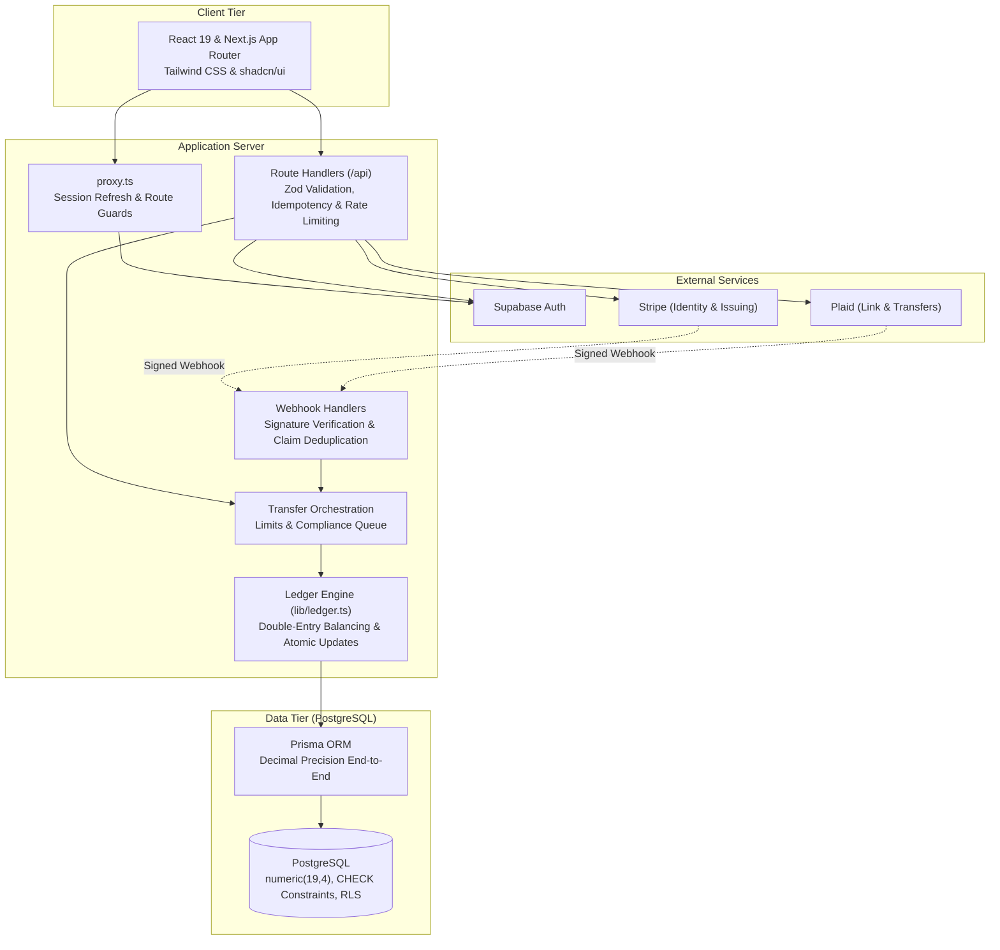

# NeoBank

A modern, full-stack core banking application engineered with double-entry accounting, real-time ledger consistency, identity verification, virtual card issuance, and peer-to-peer transfers.

Built on Next.js 16 (App Router), React 19, TypeScript, Prisma, PostgreSQL, Stripe, and Plaid.

---

## Overview

NeoBank is designed to demonstrate production-grade fintech engineering patterns. At its foundation is an immutable double-entry ledger that guarantees that money is never created or destroyed, arithmetic never suffers from floating-point errors, and concurrent transfers cannot double-spend account balances.

### Key Capabilities

- **Double-Entry Ledger Engine:** Every financial movement posts matching debit and credit entries with running post-transaction balances. System-wide ledger integrity is enforced at the database level.
- **Atomic Concurrency Control:** Debit operations use guarded conditional updates within PostgreSQL to guarantee balance sufficiency at write time, eliminating race conditions without distributed locks.
- **End-to-End Precision:** Monetary amounts are handled exclusively using arbitrary-precision decimals (`Decimal` and `numeric(19,4)`), never IEEE-754 floating-point numbers.
- **Idempotent APIs:** Financial endpoints enforce client-supplied idempotency keys (`Idempotency-Key` header) with database-level uniqueness, preventing duplicate transfers across retries and race conditions.
- **Identity Verification (KYC):** User onboarding with Stripe Identity integration. Accounts remain restricted until verification sessions complete via cryptographically signed webhooks.
- **Virtual Card Management:** Issue and manage virtual cards with customizable spending limits, real-time freeze/unfreeze toggles, and automated settlement of authorizations and refunds via Stripe Issuing.
- **Bank Account Linking (ACH):** Connect external checking and savings accounts using Plaid Link, moving funds via dedicated settlement house accounts.
- **Risk Limits & Compliance Review:** Configurable per-transaction limits, daily rolling transfer caps, and an administrative review queue for high-value transactions.
- **Webhook Deduplication:** Stripe and Plaid webhooks are verified against cryptographic signatures and deduplicated via database-backed atomic claim records.
- **Database Defense-in-Depth:** PostgreSQL `CHECK` constraints prevent negative customer balances, and Row-Level Security (RLS) prevents unauthorized data access.

---

## Architecture



### Core Design Decisions

1. **Centralized Ledger Discipline:** Account balances are updated strictly through `lib/ledger.ts`. Neither route handlers nor background tasks mutate balances directly, ensuring ledger invariants are preserved across all code paths.
2. **Guarded Write Predicates:** Balance deductions execute using guarded SQL queries (`WHERE id = :id AND balance >= :amount`) rather than naive read-then-write patterns. If another transaction debits the balance first, PostgreSQL's row-level lock re-evaluation detects insufficient funds immediately.
3. **House & Settlement Accounts:** External fund flows (such as ACH deposits or card charges) are balanced against internal settlement house accounts (`ACH_SETTLEMENT`, `CARD_SETTLEMENT`), ensuring total credits and debits always reconcile to zero.
4. **Separation of Authentication and Domain Models:** User identity and sessions are handled through Supabase Auth, while domain entities (`User`, `Account`, `Transaction`, `LedgerEntry`, `Card`) are managed in application tables through Prisma.

---

## Tech Stack

| Component | Technology | Description |
|---|---|---|
| **Framework** | Next.js 16 (App Router), React 19 | Server and client components, API route handlers |
| **Language** | TypeScript | Strict type checking throughout |
| **Styling & UI** | Tailwind CSS, shadcn/ui, Lucide Icons | Accessible, responsive banking interface |
| **Database & ORM** | PostgreSQL, Prisma ORM | Relational data persistence with strict numeric constraints |
| **Authentication** | Supabase Auth | Session management, JWT verification, and secure cookie flow |
| **Payments & KYC** | Stripe Identity & Stripe Issuing | Identity verification and virtual card management |
| **Banking Data** | Plaid Link & Plaid Transfer | Bank account verification and ACH settlement |
| **Validation** | Zod | Runtime schema validation and decimal coercion |

---

## Getting Started

### Prerequisites

- **Node.js**: v20 or higher
- **Package Manager**: `pnpm` (recommended), `npm`, or `yarn`
- **Database**: PostgreSQL 14+ or a Supabase project

### 1. Installation

Install project dependencies:

```bash
pnpm install
```

*(Note: `prisma generate` executes automatically during post-install).*

### 2. Environment Configuration

Copy the example environment configuration:

```bash
cp .env.example .env
```

Populate the required environment variables in `.env`:

```env
# Database Connections
DATABASE_URL="postgresql://postgres:[PASSWORD]@[HOST]:6543/postgres?pgbouncer=true"
DIRECT_URL="postgresql://postgres:[PASSWORD]@[HOST]:5432/postgres"

# Authentication (Supabase)
NEXT_PUBLIC_SUPABASE_URL="https://[PROJECT-REF].supabase.co"
NEXT_PUBLIC_SUPABASE_ANON_KEY="eyJ..."
SUPABASE_SERVICE_ROLE_KEY="eyJ..."

# Application URL
NEXT_PUBLIC_APP_URL="http://localhost:3000"

# Optional: Stripe (Identity & Virtual Cards)
STRIPE_SECRET_KEY="sk_test_..."
STRIPE_WEBHOOK_SECRET="whsec_..."

# Optional: Plaid (External Bank Linking)
PLAID_CLIENT_ID="your_client_id"
PLAID_SECRET="your_sandbox_secret"
PLAID_ENV="sandbox"
```

For a comprehensive guide to environment variables and production options, see [DEPLOYMENT.md](./DEPLOYMENT.md).

### 3. Database Migration

Run the committed migrations to create tables, database-level `CHECK` constraints, and Row-Level Security policies:

```bash
pnpm exec prisma migrate deploy
```

### 4. Database Seeding

Seed default system accounts, KYC-verified users, and demo transaction records:

```bash
pnpm seed
```

The seed script asserts that the sum of all account balances across the system equals `0.00` before completing.

### 5. Running the Development Server

Start the local development server:

```bash
pnpm dev
```

Navigate to `http://localhost:3000` in your browser.

---

## Project Structure

```
.
├── app/                        # Next.js App Router
│   ├── (auth)/                 # Authentication pages (login, register, verify)
│   ├── admin/                  # Administrative review dashboard
│   ├── api/                    # API route handlers
│   │   ├── ach/                # ACH transfer endpoints
│   │   ├── cards/              # Stripe Issuing card management
│   │   ├── cron/keepalive/     # Database keep-alive scheduled job
│   │   ├── transfers/          # P2P money transfers and ledger history
│   │   └── webhooks/           # Stripe & Plaid webhook receivers
│   ├── cards/                  # Virtual cards dashboard UI
│   ├── dashboard/              # Main account & transaction overview
│   └── transfers/              # Transfer initiation & contact directory
├── components/                 # React UI components & layout elements
│   ├── cards/                  # Virtual card components
│   ├── dashboard/              # Dashboard widgets & activity feeds
│   ├── transfers/              # Transfer forms, contacts & review lists
│   └── ui/                     # Design system primitives (shadcn/ui)
├── docs/                       # Technical specifications & architecture diagrams
│   ├── architecture.md         # Sequence diagrams and transaction flows
│   └── virtual-cards-setup.md  # Virtual cards configuration guide
├── lib/                        # Core application & business logic
│   ├── api-utils.ts            # Standardized API response formatting
│   ├── ledger.ts               # Core double-entry ledger engine
│   ├── plaid-webhook-verification.ts # ES256 JWKS verification for Plaid
│   ├── rate-limit.ts           # Token-bucket rate limiting utility
│   ├── transfer-utils.ts       # Transfer orchestration and limits
│   ├── utils.ts                # General utility functions and formatters
│   ├── validation.ts           # Zod schemas for input validation
│   └── webhook-events.ts       # Atomic webhook deduplication
├── prisma/                     # Database schema, migrations & seed scripts
│   ├── schema.prisma           # Prisma data models
│   ├── seed.ts                 # Database seed script
│   └── migrations/             # SQL migrations (DDL, constraints, RLS)
├── DEPLOYMENT.md               # Production deployment manual
└── proxy.ts                    # Session middleware & route protection
```

---

## Code Quality & Verification

Run static checks and validation:

```bash
# Type check TypeScript files
pnpm typecheck

# Lint codebase with ESLint
pnpm lint

# Production build test
pnpm build
```

---

## Production Deployment

Detailed deployment procedures, including connection pooling configuration, webhook signing secrets, and scheduled jobs, are documented in [DEPLOYMENT.md](./DEPLOYMENT.md).
